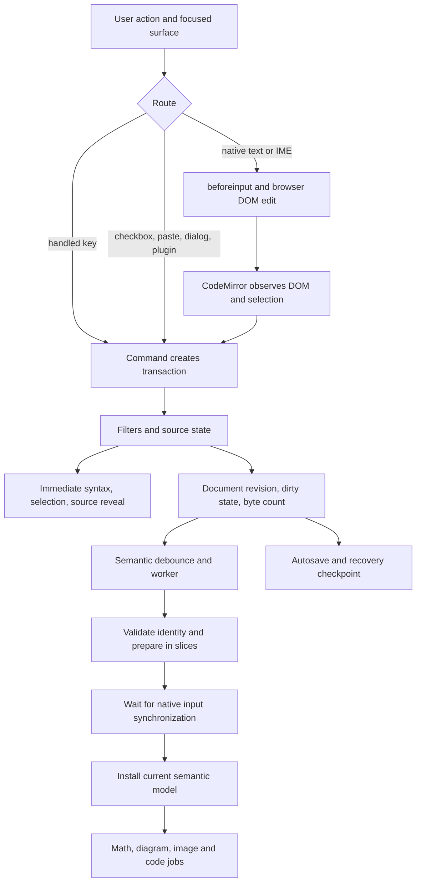

# Typora comparison: input lifecycle and linked updates

Audit date: 2026-11-11. Manuslip revision: `0e2e53e`.

Manuslip's input contract is a source transaction followed by several independently
scheduled projections. Typora documents a hybrid editor with contextual entry commands,
completion and structural editing. Comparing their rendered syntax alone misses the
differences in accepted input, caret ownership, source rewriting, undo, and feedback time.

This follow-up expands the [rendering/input inventory](typora-rendering-input.md). It
covers **input information**, **before input**, **during input**, **after input**,
**linked input effects**, **extension entry**, and **performance**. It records behavior
and implementation; it does not change production input policy.

The inventory has **197 individually identified entries**: 18 event routes, 24 input
information items, 22 admission/focus boundaries, 24 acceptance/post-input behaviors,
32 linked effects, 35 extension interactions, 26 performance details and 16 remaining
matched experiments. The evidence contains 36 traces and six typing series.

## Evidence, reproduction, and interpretation

The [observation file](typora-input-lifecycle-observations.json) contains native browser
event traces, saved source, DOM checkpoints, local performance measures, and machine
details. The [runner](../../test/benchmark/input-lifecycle.mjs) and its
[DOM instrument](../../test/benchmark/input-lifecycle-browser.mjs) reproduce the probes:

```sh
npm run build:app
node test/benchmark/input-lifecycle.mjs test/benchmark/result/input-lifecycle.json
```

`MANUSLIP_INPUT_CASES` optionally selects comma-separated trace IDs and skips the timed
typing series. Run without competing builds or tests. The runner uses an isolated
temporary profile/file, saves its seeds, verifies mode activation, disables Chromium
background throttling, records page errors, and destroys the application on completion.
It leaves the repository's production code untouched. Its assertions describe observed
contracts, including undesirable outcomes; passing is not a declaration of UX quality.

The timing series uses the built production bundle in an **unpackaged Electron process**,
on one Windows machine. It is not the repository's packaged performance gate. Native
ASCII entry uses Playwright keyboard events; Unicode chunk insertion uses Chromium's
text insertion route. IME uses DevTools `imeSetComposition` and `insertText`, not a real
OS candidate window. Clipboard probes dispatch synthetic `ClipboardEvent`s and exercise
application handlers; they do not establish OS clipboard interoperability.

Typora was not executed. Its official documentation supports user-visible contracts,
not claims about its DOM events, private transactions, debounce, data structures, or
speed. Every exact event/timing below is a **Manuslip observation**, awaiting a matched
Typora run. No Typora latency or event equivalence is inferred.

Evidence labels used below: **O** = observed in the attached traces; **S** = source
inspection; **T** = existing automated coverage; **D** = documented Typora difference;
**V** = requires a Typora executable for comparison. Multiple labels can apply.

## Findings with the largest input consequences

1. **There is no universal `beforeinput → input → render` sequence.** Enter and Backspace
   can be handled entirely by key commands; checkbox edits start from a form control;
   paste can dispatch directly; composition repeatedly replaces preedit text.
2. **DOM input information is not the accepted change.** The table filter escapes pipes
   and flattens newlines. HTML language support adds closing text. A synthetic
   `beforeinput` alone inserts nothing. A rejected transaction may still have native
   input events.
3. **Focusing the parent editor does not activate a projected block.** `Ctrl+End` followed
   by typing at a wholly projected smart-punctuation paragraph produced no insertion.
   A projected HTML block behaved similarly. Clicking the block first worked. A
   projected trailing footnote had a different failure mode: text landed on the blank
   line before the definition, rather than in its body.
4. **HTML auto-closing is inherited despite disabled suggestions.** Typing `<div>`
   produced `<div></div>`. Typing all six characters of `</div>` after `<div>text`
   produced `<div>text</div>div>` in Source and activated Live Preview. Inserting the
   entire string as one chunk produced `<div>text</div>`. This corrects I14 in the first
   report: `completeHTMLTags: false` is insufficient evidence that closing is disabled.
5. **Cell length admission precedes escaping.** Inserting 4,096 unescaped pipes into a
   selected cell produced 8,192 source units, after which the next character was
   rejected. This is a boundary inconsistency in the current implementation.
6. **Related output has a visible freshness window.** Editing a reference destination
   left the old link installed at action return; the new destination appeared by the
   next checkpoint, after the semantic refresh. Source correctness and linked visual
   correctness need separate assertions.
7. **Hidden outline still performs semantic work.** `DocumentOutline` remains mounted
   under a hidden sidebar and unconditionally subscribes to semantic navigation.
   Source-mode typing therefore continued requesting/parsing snapshots in the probes.
8. **Small callback time does not imply immediate preview.** The measured document
   callback p95 was about 0.3 ms, while final semantic freshness in the 114 KB prose
   cases was about 308–349 ms. Those are different portions of the lifecycle.
9. **The default semantic worker reparses the complete source on a cache miss.** Local
   fragment/dependency infrastructure exists, but the production browser factory
   instantiates `semantic.worker.ts`, not the experimental packed producer. Immediate
   Lezer incrementality must not be mistaken for incremental semantic parsing.

## The actual pipeline



The arrows are causal dependencies, not one synchronous call stack. The document can be
editable while a prior semantic request runs. An accepted semantic snapshot can still
contain loading math/diagram/image widgets. File persistence follows its own queue.

Primary implementation:
[editor configuration](../../packages/editor/src/index.ts),
[document callback](../../apps/desktop/src/renderer/src/document.ts),
[preview controller](../../apps/desktop/src/renderer/src/preview/controller.ts),
[semantic service](../../apps/desktop/src/renderer/src/semantics/service.ts),
[sliced application](../../apps/desktop/src/renderer/src/semantics/sliced-work.ts),
[widget rendering](../../apps/desktop/src/renderer/src/preview/widgets.ts).

## Event-level observations

`K`, `B`, `I`, `U` below mean `keydown`, `beforeinput`, `input`, `keyup`. Selection
events can follow or coalesce. Browser/version, entry method, focus and native IME can
alter sequences; these are captured examples, not cross-platform guarantees.

| ID | Exact action | Observed route | Accepted source / consequence |
| --- | --- | --- | --- |
| EV01 | Type `x` after `alpha ` | K → B(`insertText`, `x`) → I → U | `alpha x`. One printable-key event is not the authoritative change record. |
| EV02 | Insert `é👩🏽‍💻` as a chunk | B → I, no K/U | Exact combining/ZWJ source retained. Keyboard-only instrumentation misses this entry. |
| EV03 | Enter after `alpha` | K prevented → U; no B/I | One LF inserted by `insertNewline`. |
| EV04 | Shift+Enter after four-space indentation | Modifier K, Enter K prevented, U | LF plus four spaces inserted by inherited indentation command. |
| EV05 | Backspace after `alpha` | K prevented → U; no B/I | `alph`. Deletion is not observable solely from `input`. |
| EV06 | Type `(` | K → B → I → U | Only `(`, no bracket pair. |
| EV07 | Synthetic paste offers plain and HTML | `paste` prevented; no native B/I | Plain representation preserved; CRLF normalized to LF; Markdown syntax remains source. |
| EV08 | Dispatch synthetic B with `NEVER_INSERTED` | B only, untrusted | No source change. Event dispatch is not native editing. |
| EV09 | IME preedit `shi` → `世界` → commit | composition start/update; repeated B/I `insertCompositionText`; composition end | `alpha 世界`, not `alpha shi世界世界`. Intermediate candidate text is not additive keystrokes. |
| EV10 | Complete `**bold**` | Ordinary B/I insertion | Source delimiter accepted first; Lezer decoration and semantic projection are separate responses. |
| EV11 | Complete `$x$` | Ordinary B/I insertion | Later math widget replaces the formula; math count changes from 0 to 1. |
| EV12 | Enter after opening code fence | Handled K, no B/I | Raw LF; no matching closing fence generated. |
| EV13 | Cell chunk `a\|b` with an unescaped input pipe and LF | B data contains `a`/pipe/`b`/LF/`c`; Chromium emits multiple I events | Final cell source is `a\|b c`; original input data is not final inserted spelling. |
| EV14 | Cell Enter | Handled K | Changes cell/exit position; table source unchanged. |
| EV15 | Click task checkbox | `click` → generic form-control `input` → `change` | `[ ]` becomes `[x]`; the `input` event is not an `InputEvent` with text data. |
| EV16 | Undo then redo | Handled modifier keys; no B/I required | Source returns to exact `alpha xyz`. Undo grouping is transaction history, not DOM event counting. |
| EV17 | Type `</div>` character by character | Six B/I pairs plus inherited completion dispatch | Auto-generated `div>` after slash explains the extra suffix. |
| EV18 | Disable LaTeX in preferences | No editor input events | Existing `$x$` becomes literal; source unchanged; new semantic intent required. |

EV13's source uses a Markdown backslash escape; the actual injected text has no backslash
before its pipe. See the JSON `data` and `sourceAfter` fields for unambiguous spellings.

## Input information: what each layer knows

Offsets must carry their coordinate system. Native DOM anchor `5`, source position `5`,
rendered glyph `5`, a table's cell-relative `5`, and a TeX SVG `data-source-from="5"`
are not interchangeable. The trace intentionally records native node-local offsets
separately from saved source; it does not inspect private editor state.

| ID | Information | Manuslip handling and comparison implication | Evidence |
| --- | --- | --- | --- |
| IN01 | Physical key and code | `key`, `code`, modifiers and repeat describe a key action, not necessarily text. Shortcut branches consume them. | O/S/V |
| IN02 | Text without a physical key | Unicode chunk insertion supplies text input without keyboard events. OS paste, dictation and IME also need independent testing. | O/V |
| IN03 | `inputType` | Distinguishes `insertText`, `insertCompositionText`, deletion, replacement, etc. Only native routes provide it; commands annotate transactions separately. | O/S/V |
| IN04 | Input `data` | May be null, a whole composition candidate, one character, or a chunk. It cannot be appended blindly to reconstruct source. | O/V |
| IN05 | Trust | Native browser events were trusted; synthetic clipboard/control events were not. Image capture explicitly rejects untrusted imports. | O/S/V |
| IN06 | Cancelability | Capture both `cancelable` and final `defaultPrevented`. Composition events need not be cancelable; a canceled key may produce no B/I. | O/V |
| IN07 | Final prevention | Capture-phase observation precedes editor handlers. A microtask can run too early during native dispatch; the probe uses a later task plus document bubbling. | O/V |
| IN08 | Native target ranges | Recorded `getTargetRanges()` can be empty. Never assume a usable source replacement interval comes from this API. | O/V |
| IN09 | Native selection | Anchor/focus offsets are node-local UTF-16 positions. Decoration replacement and DOM redraw can change nodes while source selection stays logical. | O/S/V |
| IN10 | Source selection | CodeMirror keeps ordered ranges, main index, anchor/head and association. Parent permits multiple ranges. Native DOM selection is insufficient to reconstruct them. | S/T/V |
| IN11 | Cell selection | Child offsets are relative to authored cell body; forwarding adds `current.from` and sparse-cell padding. | O/S/T/V |
| IN12 | Rendered hit | Click mapping builds a bounded source map for the selected block/cell; hidden delimiters, entities and HTML tags require special treatment. | S/T/V |
| IN13 | TeX/diagram hit | Rendered source annotations map to expression value, then delimiters/indentation map value into source. A glyph's position is not a DOM text offset. | S/T/V |
| IN14 | String length | Source positions and cell's 4,096 limit use UTF-16 code units. Grapheme count and UTF-8 bytes differ. | O/S/V |
| IN15 | Unicode example | `e` plus combining acute is 2 units; `👩🏽‍💻` is 7; together they occupy 9 units and 18 UTF-8 bytes but 2 user-perceived graphemes. | O/S/V |
| IN16 | Status column | Main-head position minus line start plus one; this is a UTF-16 source column, not visual x, grapheme count, or tab-expanded column. | S/V |
| IN17 | Byte accounting | Incremental UTF-8 accounting scans changed ranges plus neighboring units to handle surrogate pairs; document is not flattened for each count. | S/T/V |
| IN18 | Transaction changes | The accepted `ChangeSet`, not event `data`, defines replaced ranges and resulting rope. Filters can transform or reject it. | S/T/V |
| IN19 | Transaction origin | `Transaction.userEvent` includes `input`, `input.paste`, `input.table`, `input.spelling`, `input.replace.all`, and inherited `input.complete`. Not all are native input. | S/V |
| IN20 | Revision | Increments by the number of document-changing transactions passed to the document callback; not by keys, graphemes, DOM `input`s, or saves. | S/V |
| IN21 | Dirty state | Compares actual source rope with saved baseline; undo back to baseline can become clean while revision still increases. | S/T/V |
| IN22 | Semantic identity | Document ID, generation, revision, sequence and consumer intent distinguish results; syntax options can change without changing revision. | S/T/V |
| IN23 | Diagnostic detail | Production measures retain scalar timing/flags, not text. Exploratory traces deliberately contain only authored test fixture text. | S/O |
| IN24 | Installed browser input API | Bundled CodeMirror enables EditContext on its Android path; inspected Windows path uses DOM mutation handling. The barrier listens to either target when present. | S/V |

Sources: [position mapping](../../packages/editor/src/live-position.ts),
[delimiters](../../packages/editor/src/live-source-position.ts),
[selection painting](../../packages/editor/src/selection.ts),
[bytes](../../packages/editor/src/limits.ts),
[document metadata](../../apps/desktop/src/renderer/src/document.ts),
[metrics](../../apps/desktop/src/renderer/src/semantics/metrics.ts).
The inherited HTML behavior is in installed `@codemirror/lang-markdown`'s
`htmlNoMatch.support` and `@codemirror/lang-html`'s `autoCloseTags` input handler;
inspect the lockfile-pinned dependencies when upgrading.

## Before input: admission, focus, and ownership

| ID | Boundary | Current Manuslip behavior | Typora comparison |
| --- | --- | --- | --- |
| BF01 | Native focus | `.cm-content` focus alone may leave a projected block without an editable native caret. | V: compare end-of-document, Home/End and refocus across projected blocks. |
| BF02 | Explicit activation | Click, or the block's supported keyboard target, opens a mapped source session. No document edit is required. | V: compare exact activation and first character. |
| BF03 | Smart paragraph at EOF | Parent focus + Ctrl+End + quote produced K/U without B/I or insertion; clicking paragraph first accepts it. | O; V for Typora. |
| BF04 | HTML block at EOF | Parent focus + Ctrl+End + literal close-tag entry produced no source edit before activation. | O; V for Typora. |
| BF05 | Trailing footnote | Ctrl+End did not target the projected definition body; text went on the blank line before it. Explicit click then Ctrl+End edited the body. | O; V for Typora. |
| BF06 | Math keyboard target | The inner `[role=math]` is focusable and advertises Enter/Space. Focusing only the outer wrapper does not establish the same activation route. | O/S; V for Typora. |
| BF07 | Block activation guards | Refuses activation when read-only, composing, model composing, or detached; tables/emoji have their own routes. | S/T; V for Typora. |
| BF08 | Pointer intent | Plain primary pointer/click activates; modifiers, drag/selection intent and interactive controls take separate branches. | S/T; V for Typora. |
| BF09 | Global shortcuts | Main keymap includes mode/save and literal Enter/Tab, then default/search/history maps. Higher-priority live handlers can intercept first. | D: Typora shortcuts have other meanings; see original K inventory. |
| BF10 | Markdown keymap | `addKeymap: false` suppresses Markdown continuation commands. Lists/quotes do not gain a marker from Enter. | D: contextual Markdown input differs. |
| BF11 | Bracket matching | Installed matching highlights the partner; it does not insert the partner. | D: Typora offers optional bracket/quote pairing. |
| BF12 | HTML suggestions | `completeHTMLTags: false` disables completion data, while HTML input handlers remain installed. | V: compare completion suggestions and automatic insertion independently. |
| BF13 | URL-over-selection paste | Markdown URL wrapping disabled. Plain source insertion remains ordinary paste behavior. | D: Typora documents link conversion/paste behaviors. |
| BF14 | Read-only parent | State/read-only and editable facets gate commands/native entry; programmatic dispatch callers still need guards. | V: verify input, paste, task, table, spelling and plugin separately. |
| BF15 | Parent size admission | Edits over 50 MiB UTF-8 become a `limitRejected` effect, preserving source and reporting `file-large`. | S/T; V for Typora limits. |
| BF16 | Child size admission | Cell new document over 4,096 UTF-16 units rejected before transformation. Escape expansion can exceed the intended cap. | O/S; V for Typora limits. |
| BF17 | Paste during composition | Custom paste handler declines interception when composing; this does not prove every native paste is globally blocked. | S; V: test actual OS IME clipboard behavior. |
| BF18 | Pending large paste | One pending job; another intercepted paste reports `paste-busy`. Ranges captured before asynchronous preparation. | S/T; V for Typora. |
| BF19 | Pending replace-all | Captures document/query; later source/query changes cancel the job. Selection movement alone is not a text change. | S/T; V for Typora. |
| BF20 | Command barrier | Save, mode switch and document/menu workflows wait for native input consumption, including embedded child input. | S/T; V for Typora. |
| BF21 | Barrier completion | Waits for composition end and a public CodeMirror measurement write; no arbitrary delay declares the input committed. | S/T; V for Typora. |
| BF22 | View destruction | Closing the synchronization object resolves queued waits and removes listeners; callers must recheck disposed/view ownership. | S/T; V for Typora. |

Sources: [configuration](../../packages/editor/src/index.ts),
[syntax support](../../packages/editor/src/syntax.ts),
[activation](../../packages/editor/src/live-interactions.ts),
[input synchronization](../../packages/editor/src/input-synchronization.ts),
[embedded ownership](../../packages/editor/src/embedded-editor.ts),
[paste](../../apps/desktop/src/renderer/src/paste.ts),
[replace-all](../../apps/desktop/src/renderer/src/replace.ts).
Typora references: [pairing](https://support.typora.io/Auto-Pair/),
[shortcuts](https://support.typora.io/Shortcut-Keys/),
[copy/paste](https://support.typora.io/Copy-and-Paste/).

## During input and immediately after acceptance

| ID | Stage | Implementation consequence | Evidence |
| --- | --- | --- | --- |
| AF01 | Key command | Enter creates source LF immediately; event `data` is irrelevant. Shift+Enter inherits indentation; Tab inserts a tab in main editor. | O/S/D |
| AF02 | Native character | Browser edits DOM, CodeMirror observes and constructs source transaction. A DOM checkpoint can precede semantic freshness. | O/S/V |
| AF03 | HTML `>` | In HTML context the inherited input handler can dispatch typed input plus generated closing tag in one view update. | O/S/V |
| AF04 | HTML `/` | In incomplete closing-tag context generates tag name and `>` with `input.complete`, moving selection after it. No general closing-tag overtype is implied. | O/S/V |
| AF05 | Whole-string HTML | `insertText('</div>')` is a chunk; the handler's single-character `/`/`>` guards do not take the same path. | O/S/V |
| AF06 | Filter ordering | Parent validates final transaction byte length. Child first checks cell length then adds escapes/normalization. These admissions are not equivalent. | O/S/T/V |
| AF07 | Cell changes | Child `ViewUpdate.changes` forwards into parent source. Sparse cells can materialize separator/padding; focus alone leaves source unchanged. | O/S/T/V |
| AF08 | Cell history | Child installs no independent history; Mod+Z/redo invoke parent history. Child transformed changes aggregate before parent dispatch. | S/T/V |
| AF09 | Parent callback | Maps pending paste; invalidates replacement job; accepts new state/status; updates table staleness; informs preview and reading copy, in that order. | S/V |
| AF10 | Selection-only update | Updates line/column and selection-dependent decorations without increasing document revision or scheduling a new semantic parse from `changed`. | S/T/V |
| AF11 | Immediate inline syntax | Visible-range Lezer decorations hide/reveal markers before semantic output; selection and active source ranges can expose them. | S/T/V |
| AF12 | Changed semantic block | Old projection touching edited source is removed; unaffected blocks map through change offsets. It is not necessary to remove the entire rendered document. | S/T/V |
| AF13 | Task fast path | Exact same-length checkbox-marker edit updates rendered checkbox serialization locally and preserves the containing semantic block. | S/T/V |
| AF14 | Source session lifetime | Session maps its boundaries with opposite associations; full replacement or selection leaving its range ends it. Ordinary caret residence does not. | S/T/V |
| AF15 | Semantic refresh | New model can re-resolve the session; code/math/diagram/HTML kinds can transition at the same source start without losing editing ownership. | S/T/V |
| AF16 | Composition start | Cancels pending paste/replace; publishes composing; disables normal autosave scheduling; live decoration/projection logic defers disruptive replacement. | S/T/V |
| AF17 | Composition candidate | Multiple preedit changes can already update source/revision. The final commit is not necessarily the first source mutation. | O/S/T/V |
| AF18 | Composition end | Main callback clears composing in a microtask only when CodeMirror no longer reports an active composition. Child also synchronizes after measurement. | S/T/V |
| AF19 | Save request | Queued save waits for input barrier, captures source/revision, then writes through bridge. Saved acknowledgement belongs to that captured revision. | S/T/V |
| AF20 | Edit during save | Acknowledged source becomes baseline; later edits remain dirty. Older completion cannot mark newer text clean. | S/T/V |
| AF21 | Autosave | 750 ms idle, maximum nominal wait 5 s, gated by dirty/named/conflict/error/composition/encoding/newline conditions. It is not an input-event hook. | S/T/V |
| AF22 | Recovery checkpoint | Separate queue: normally 2 s, 10 s above 1 MiB; uses revision checks and source snapshot. | S/T/V |
| AF23 | Undo grouping | Native typing groups in parent CodeMirror history; paste/table-dialog/spelling/replace-all explicitly isolate history where implemented. Rendering-only effects add no source edit. | O/S/T/V |
| AF24 | External disk change | Dirty/saving/composing document reports conflict rather than blindly replacing its source; clean document can reload. | S/T/V |

Sources: [document callback/persistence](../../apps/desktop/src/renderer/src/document.ts),
[model mapping](../../packages/editor/src/live-model-changes.ts),
[task mapping](../../packages/editor/src/live-task-changes.ts),
[source session](../../packages/editor/src/live-editing.ts),
[cell forwarding](../../packages/editor/src/live-table.ts).

## Linked effects: what else an input invalidates

An edit can be local in source and global in meaning. A changed definition affects
references elsewhere; an inserted heading changes automatic IDs/TOC; the first reference
can alter footnote ordering. Keeping a DOM node mounted does not guarantee its meaning is
already current. The accepted snapshot supplies the authoritative derived information.

| ID | Trigger | Immediate state | Deferred or linked consequence |
| --- | --- | --- | --- |
| LK01 | Insert before unaffected block | Source and selection change; block range maps | Existing widget can remain while new revision is prepared. |
| LK02 | Edit inside projected block | Touching projection removed, source session retained where valid | New parsed projection replaces or accompanies edited source. |
| LK03 | Reference URL edit | Destination source changes | Every use of that definition must receive new href/title; observed old href at action return, new href after refresh. |
| LK04 | Reference label rename | Definition/reference relationship may break | Resolved links can become literal; creating a matching definition can make earlier text render. |
| LK05 | Duplicate definition edit | Parser-selected definition may change | First-definition selection and normalized identifiers must be respected, not just same-text matching. |
| LK06 | Footnote body edit | Active definition source changes | Footer content/backlinks depend on new snapshot; source edit does not imply the rendered footer is already current. |
| LK07 | Footnote first-call order edit | Source call ranges map | Numbering and repeated-reference occurrence/backlink IDs can change beyond edited block. |
| LK08 | Inline footnote edit | Inline source changes | Normalized synthetic definition and rendered reference must update together. |
| LK09 | Heading text edit | Heading line source changes | Outline label, generated heading anchor and TOC text/href refresh. Observed with Typora extension enabled. |
| LK10 | Heading depth edit | Structural syntax changes | TOC nesting/outline structure require recomputation. |
| LK11 | Explicit/duplicate heading ID edit | Authored ID or slug source changes | Other generated IDs may change because explicit IDs are reserved before automatic allocation. |
| LK12 | Manual internal link | Link source does not change with heading rename | No rename-refactor mechanism rewrites authored `(#old-id)`; newly generated anchors can leave it stale. |
| LK13 | YAML fence edit | Frontmatter boundary field and mixed language can change immediately | Body parse eligibility, hidden fence geometry, and excluded metadata change; no YAML schema completion is installed. |
| LK14 | YAML scalar edit | Source/YAML highlighting updates | No frontmatter-driven image root, math macro or export-variable input behavior should be inferred without a consumer. |
| LK15 | Task toggle | Source one-character edit and local checkbox update | Dirty/revision/autosave and semantic consumers still receive the change. |
| LK16 | Table cell edit | Child and parent source update | Cell range/layout synchronization is queued; table model may refresh without replacing the focused child. |
| LK17 | Sparse cell first edit | Missing source separators materialized | Child/parent absolute position mapping gains prefix offset; selection must move through that padding. |
| LK18 | Structural table draft | HTML form fields change only draft | Apply writes one isolated source edit; intervening source revision makes the draft stale. |
| LK19 | Math body edit | Source session keeps expression text | Semantic delimiter recognition, then separate math worker/SVG installation; last stage is not covered by semantic-ready alone. |
| LK20 | Macro definition in one math block | Local TeX text changes | Fresh TeX instance per formula; no document-global macro propagation to later formulas. |
| LK21 | Diagram source edit | Source remains editable | Reparse classification, diagram job, sanitized SVG and later layout/scroll measurement are separate. |
| LK22 | Diagram theme change | No source input required | Existing diagram aborts old job and renders current theme; source/occurrence identity still matters. |
| LK23 | Image URL edit | Authored URL changes | Path/remote permission resolution and load may finish later; previous consumer is abortable. |
| LK24 | Save As | Source may be identical | New path base refreshes assets/reading rendering; a visual change need not imply a text edit. |
| LK25 | Grammar preference change | Same source revision; metadata compartment/model reset | New consumer generation/intent invalidates old grammar result; revision equality alone is insufficient. |
| LK26 | Raw HTML toggle | Same source; old model removed | New sanitized/literal projection; setting is independent from source language auto-closing. |
| LK27 | Translation source edit | Captured reading source/projection is frozen and marked stale | Occurrences map, but old provider responses do not turn captured reading into a live rewrite of current source. Explicit refresh required. |
| LK28 | Plugin transform finishes | Result belongs to captured revision | Apply waits for input, rechecks installed fingerprint/grants, then rejects stale source. No automatic per-keystroke plugin hook. |
| LK29 | Search replace-all finishes | Captured query/doc validated | Any source edit/query change cancels; accepted result is one isolated source operation, then all downstream consumers update. |
| LK30 | Pending paste and surrounding edit | Captured insertion ranges map with source | Overlap with selected replacement range invalidates; composition/cancel/disposal can discard work before commit. |
| LK31 | Spell correction arrives | Captured word/range/revision validated after input barrier | Must still have same view, focus, selection, source word, enabled spelling and writable state. |
| LK32 | Inactive tab | Source/history retained | Derived snapshots/widgets released; later activation re-establishes current semantic state. |

Sources: [dependencies](../../packages/core/src/semantic-dependencies.ts),
[document transforms](../../packages/core/src/document-transforms.ts),
[table draft](../../apps/desktop/src/renderer/src/table.ts),
[translation staleness](../../apps/desktop/src/renderer/src/translation/controller.ts),
[plugin lifecycle](../../apps/desktop/src/renderer/src/plugins.ts),
[math instance](../../packages/renderer/src/math.ts),
[diagram rendering](../../apps/desktop/src/renderer/src/preview/diagram-widget.ts).
These establish Manuslip behavior; exact Typora propagation and timing remain V.
Typora documents [reference/internal links](https://support.typora.io/Links/) and
[TOC updates](https://support.typora.io/TOC/), but those pages do not establish its
private dependency graph.

## Extension entry and editing surfaces

The preference names are **Opt**, **LaTeX**, **Mermaid**, **GitHub**, **Typora**. They
primarily configure interpretation/projection. The `Typora` switch covers frontmatter
and TOC; it does not install Typora's complete input behavior. Defaults: Opt/LaTeX/Mermaid
on, GitHub/Typora off. Tables/tasks/footnotes/smart punctuation/heading attributes/
superscript/subscript are base support. Sanitized HTML is a separate option.

| ID | Feature / input | Before and during entry | After and linked behavior / Typora difference |
| --- | --- | --- | --- |
| EX01 | Strong/emphasis | Markers typed literally; no Markdown pair/surround command installed | Lezer styling/reveal; D versus optional Typora symbol pairing. |
| EX02 | Highlight/strike, Opt | Interpretation toggle; `==`/`~~` still authored text | Toggle can alter rendering without rewriting; no highlight selection-surround automation. |
| EX03 | Superscript/subscript | Literal `^`/`~` source, no dedicated entry UI | Semantic projection and source mapping; Typora documents selection wrapping when enabled. |
| EX04 | Emoji shortcode | Literal `:name:`; lookup after syntax completion | Rendered emoji/source hint; no shortcode suggestion picker; D versus Typora emoji completion. |
| EX05 | Direct Unicode emoji | Native text/IME route, exact code points retained | Movement/backspace/hit mapping need grapheme tests separately from shortcode parsing. |
| EX06 | Lists | Main Enter inserts LF; Tab inserts tab | No continued marker/automatic renumbering from entry; D versus structural hybrid editing. |
| EX07 | Quotes/callouts | Literal marker entry; GitHub enables interpretation of alerts | No continuation keymap; semantic reclassification can change whole quote projection. |
| EX08 | Task text | Same main-editor source path as lists | Checkbox is separate UI transaction; source `x`/`X` parsing and pointer toggling are separate cases. |
| EX09 | Table creation | Literal pipes/separator row; no dedicated header-only creation input rule | Semantic recognition enables table widget. Typora documents header entry → Enter creation. |
| EX10 | Table ordinary cell | Embedded CodeMirror, 4,096-unit pre-transform cap | Parent authoritative source/history, automatic pipe escaping and LF flattening. |
| EX11 | Table Enter/Shift+Enter | Move ±number-of-columns in flat cell grid | End of grid exits; no new row. Typora documents Ctrl+Enter row insertion. |
| EX12 | Table Tab/Shift+Tab | Move ±1 cell | Final Tab exits without row; D versus Typora final-Tab row creation. |
| EX13 | Table document shortcuts | Child forwards Ctrl/Cmd S, 1, 2, F to parent scope; parent save uses barrier | Other shortcuts follow child/default/global routes; do not assume main-map parity. |
| EX14 | Table paste/images | Child lacks parent's `DocumentPaste` extension | No identical large-paste slicing/image import behavior; native plain cell paste then cell filter. |
| EX15 | Table spelling/selection | Child explicitly `spellcheck=false`, no parent multi-selection configuration | Enabling spelling in main editor does not enable the cell. |
| EX16 | Structural table dialog | Separate draft fields and navigation | Apply/Cancel, stale revision checks, isolated history; distinct from immediate cell edits. |
| EX17 | Inline math delimiters | Literal `$`, `\(` etc.; no LaTeX completion input UI | Semantic parse then math job; default dollar acceptance differs from Typora's documented Pandoc-like rules. |
| EX18 | Display math entry | `$$` + Enter uses literal newline | No generated closing `$$`; D versus Typora's dedicated entry/exit interaction. |
| EX19 | Activated math editing | Focus inner math target and Enter/Space, or click expression | Parent source editor with companion preview; tested `Q` insertion in body. |
| EX20 | Matrix/chemistry | TeX source, no matrix/grid/chemistry input palette | MathJax support is renderer capability, not editor completion capability. |
| EX21 | Math macros/labels | No document-global TeX state or automatic equation numbering implemented | Do not infer linked labels/macros from MathJax package availability. |
| EX22 | Code fence body | Parent source; Enter LF and inherited Shift+Enter indentation | Language highlighting loads separately; no fence generation/language-picker input rule. |
| EX23 | HTML text | HTML mixed-language input handler survives disabled tag suggestions | Single-character `>`/`/` completion differs from chunk insertion; raw-HTML render permission does not disable it. |
| EX24 | Sanitized HTML projection | Click rendered block exposes parent source plus companion | Native input edits source, not arbitrary rendered element attributes/content. |
| EX25 | Mermaid | Fenced source; no node/edge graphical editor or diagram syntax completion | Dedicated abortable render host; valid source, semantic classification and SVG readiness are separate. |
| EX26 | Legacy flow/sequence | Rendering adapters accept supported fenced syntax | No dedicated graphical input model; same source activation/keyboard route as diagram block. |
| EX27 | Frontmatter | YAML mixed syntax, hidden fences in Live when Typora enabled | Typed key/value remains source; no schema UI or automatic metadata-to-document field insertion. |
| EX28 | TOC | Literal `[TOC]`; no dedicated creation command on Enter | Heading edit updates TOC via semantic model; no rewrite of authored heading links. |
| EX29 | Definition list | Literal term/colon entry | Whole block projection/source mapping; no definition-list continuation keymap. |
| EX30 | Footnote | Literal reference/definition entry, explicit body activation for projected footer | Numbering/backlink projection; no footnote-creation command or popup editor installed. |
| EX31 | Smart punctuation | ASCII source unchanged; semantic transform projects curly quotes/dashes | No preference to disable the transform currently; input focus differs once paragraph becomes a projection. |
| EX32 | GitHub URL autolink | Preference controls bare-URL interpretation | No URL-over-selection paste wrapping; that is a separate disabled input feature. |
| EX33 | Local/remote images | Literal Markdown or separate clipboard-image import | Named-path/permission/load lifecycle; no embedded image-resize source input controls equivalent to Typora's documented sizing syntax. |
| EX34 | Executable plugins | Explicit command captures source after synchronization | Transform result reviewed/applied with revision guard; no generic beforeinput/afterinput plugin event bus exposed. |
| EX35 | Translated reading | Captured projection, not writable primary source | Editing source marks it stale; provider arrival and layout changes do not mutate authoritative source. |

Relevant Typora contracts:
[table editing](https://support.typora.io/Table-Editing/),
[math](https://support.typora.io/Math/),
[code fences](https://support.typora.io/Code-Fences/),
[HTML](https://support.typora.io/HTML/),
[YAML](https://support.typora.io/YAML/),
[diagrams](https://support.typora.io/Draw-Diagrams-With-Markdown/),
[smart punctuation](https://support.typora.io/SmartyPants/),
[spelling](https://support.typora.io/Spellcheck/).
Detailed syntax/default differences remain in the original report; this table traces
their input consequences. Installed grammar supports features independently of an
autocomplete menu, toolbar command, or structural editor.

## Scheduling and performance implementation

| ID | Operation | Actual granularity / limit | Implication |
| --- | --- | --- | --- |
| PF01 | Native source state | CodeMirror rope/transactions, synchronous acceptance | The semantic 150 ms delay does not delay every source mutation. |
| PF02 | Editor callback metric | Starts inside `DocumentController.updated` | Omits earlier transaction construction/filtering/plugin work, browser DOM reconciliation and subsequent paint. |
| PF03 | Byte accounting | Changed ranges with one-unit neighbors | Avoids flattening entire document on each key, while preserving surrogate accounting. |
| PF04 | Lezer inline bound | 32,768 UTF-16 units per oversized inline leaf | Falls back to `UnparsedInline`; semantic worker still receives full original source. |
| PF05 | Semantic idle delay | 150 ms after last request; maximum publication timer 1,000 ms | Maximum timer publishes work eligibility; it is not a guarantee that output appears within 1 s. |
| PF06 | Worker backpressure | One running request, one replaceable latest pending request | Old work may consume resources even though its result cannot install. |
| PF07 | Snapshot source flattening | Captured immutable source flattened when request starts | Not on every request enqueue, but still a whole-source operation when published. |
| PF08 | Identity checks | Consumer/generation/revision/intent plus request validation | Prevents stale installation; input frequency can increase discarded work. |
| PF09 | Current grammar path | Desktop uses `parseDocumentMarkdown` and convention options | A lower-level parser benchmark does not establish application keystroke latency. |
| PF10 | Experimental fragment admission | Verified root/identity, supported blocks, plain letter/number/mark/space change, ≤64 KiB and other budgets | Punctuation, dependency overlap, grammar/boundary/context changes require full fallback. This infrastructure is not the default browser semantic worker. |
| PF11 | Experimental dependency context | Selected link/footnote definitions and indexed references | Local edit eligibility must preserve global meaning; inability to prove ranges leads to full recompute. Default worker still reparses whole documents. |
| PF12 | Default parser/cache route | Browser factory creates native semantic worker; exact source/options cache hit skips parsing, otherwise `parseDocumentMarkdown` parses whole source | `cached` does not mean a fragment parse. Configured document metadata also excludes the optional packed-preview admission path. |
| PF13 | Main-thread preparation | Cooperative `SlicedWork`, target 1 ms per slice | One iterator step can exceed target; requested slice size is not a hard scheduling bound. |
| PF14 | Commit preparation | Rechecks validity and waits for input synchronization before installation | Semantic apply wall time can include asynchronous waiting; active slice time differs. |
| PF15 | Semantic readiness | Current model/status installed | Does not mean async math SVG, diagram SVG, image or syntax-highlight work has finished. |
| PF16 | Widget lifecycle | Abort signals, per-widget accounting, queued code jobs (up to 3) | Detached/superseded jobs must not install late output; layout can occur after source/semantic completion. |
| PF17 | Preview ceiling | 2 MiB UTF-8, 50,000 semantic blocks; other message/cache budgets | Editor supports up to 50 MiB; crossing preview admission falls back to source without discarding accepted text. |
| PF18 | Math ceiling | 4,096 UTF-8 bytes expression, 200 mounted formulas, 2 s watchdog | Limit/error/retry is distinct from input rejection; formula source can remain editable. |
| PF19 | Cell filter | Full cell string scan each changed transaction, normally bounded by 4,096 units | Escaping overflow undermines that nominal bound and can trap further insertion. |
| PF20 | Large plain paste | ≥256 KiB interception; 64 KiB preparation chunks, CRLF/surrogate boundary handling | Preparation yields; final transaction/DOM work still needs independent timing. |
| PF21 | Replace-all | Source collection yields every 256 lines, worker search, sliced change preparation, one commit | Worker offload does not remove final acceptance/rendering cost. |
| PF22 | Source mode with outline | Outline subscription is unconditional while mounted, even hidden | Source-mode runs here still include semantic parsing. Sidebar visibility is not a valid proxy for subscription. |
| PF23 | Input benchmark helper | Existing helper measures two rAF callbacks from printable keydown | Excludes IME/chunk/handled-key paths and does not verify accepted source or compositor presentation. |
| PF24 | Timing retention | Same-name production measures cleared at 200 entries | PerformanceObserver collects continuously so a final entry snapshot cannot silently lose earlier samples. |
| PF25 | Background throttling | Unfocused/occluded Electron windows can delay frame callbacks substantially | Pin throttling/focus/visibility; otherwise seconds of frame delay can be misattributed to editing work. |
| PF26 | Autosave/checkpoint | Concurrent I/O preparation/source flattening on separate timers | Performance runs must disclose persistence/profile settings and warm/cold state. |

Sources: [limits](../../packages/core/src/contracts.ts),
[default worker factory](../../apps/desktop/src/renderer/src/semantics/browser.ts),
[whole-document worker/cache](../../apps/desktop/src/renderer/src/semantics/semantic.worker.ts),
[packed-preview admission](../../apps/desktop/src/renderer/src/semantics/packed-admission.ts),
[local fragment proof](../../packages/core/src/markdown-fragment.ts),
[packed fragment caller](../../apps/desktop/src/renderer/src/semantics/packed-producer-fragment.ts),
[service](../../apps/desktop/src/renderer/src/semantics/service.ts),
[slices](../../apps/desktop/src/renderer/src/semantics/sliced-work.ts),
[large-paste normalization](../../apps/desktop/src/renderer/src/paste-text.ts),
[outline subscription](../../apps/desktop/src/renderer/src/DocumentOutline.tsx),
[hidden outline mount](../../apps/desktop/src/renderer/src/App.tsx),
[existing timing helper](../../test/benchmark/input.ts).

## Observed timing, with the boundaries kept separate

Machine: AMD Ryzen 7 9700X, Windows `10.0.26300`, Electron 45 / Chromium 156,
1,200 × 900 viewport. Each case typed 78 ASCII characters at a requested 25 ms delay
after warmup. Six cases give **468 accepted typing samples**. All six saved suffixes
matched. No renderer long task was reported in these samples; this is not an absence
claim for other documents/actions. Prose sizes below exclude the small input suffix.

| Fixture | Mode | UTF-8 bytes | Callback p95 ms | First rAF p95 ms | Second rAF p95 ms | Final semantic freshness ms |
| --- | --- | --- | --- | --- | --- | --- |
| Prose ×20 | Source | 1,520 | 0.3 | 13.0 | 26.0 | 166.6 |
| Prose ×20 | Live | 1,520 | 0.3 | 12.1 | 23.1 | 157.8 |
| Prose ×1,500 | Source | 114,000 | 0.3 | 11.6 | 24.6 | 307.5 |
| Prose ×1,500 | Live | 114,000 | 0.3 | 11.1 | 22.6 | 349.4 |
| Mixed extensions ×30 | Source | 3,210 | 0.3 | 11.3 | 21.9 | 186.7 |
| Mixed extensions ×30 | Live | 3,210 | 0.3 | 11.7 | 23.6 | 161.8 |

Callback is only `editor-update`, measured inside the document controller. rAF values are
**scheduling proxies**, not presentation latency or source-acceptance latency. The script
does not align an individual character with a compositor frame. Final freshness is the
last installed semantic snapshot's metric, including the debounce since its newest
captured request, not the duration since the first key of the whole typing burst.

Mixed extensions include smart punctuation, headings, inline math, tables and footnotes;
typing occurs in a plain tail paragraph. Thus this series measures the effect of that
document around ordinary input, not 78 edits inside every table/math/diagram widget.
Expensive widgets are viewport-driven. Do not describe this as a stress test of all
offscreen formulas or diagram generation.

In the 114 KB cases only one semantic application completed during each recorded burst,
despite multiple requests. New edits superseded other requests/results. This is why
the six final freshness observations are reported directly, rather than presenting a
meaningless semantic p95 from one result as a robust distribution. Parser/request time,
active slice time and elapsed apply time remain separately available in the JSON.

No Typora performance comparison is claimed. For a matched comparison, use identical
source, viewport, font, extension preferences, renderer focus/throttling, save policy,
input method, and cold/warm state. Measure source acceptance, selection correctness,
linked visual freshness, final widget readiness, and persistence independently.

## Remaining input probes needed for Typora parity

These are distinct unknowns, not missing Manuslip features inferred from documentation.

| ID | Matched experiment | Required oracle |
| --- | --- | --- |
| NX01 | Every rendered kind at beginning/end, Ctrl+Home/End, refocus, first printable key | Exact saved source and caret target before/after activation. |
| NX02 | Selection ending on hidden delimiter, reverse selection, nonempty selection across widgets | Source ranges, native selected text, replacement result and copy result. |
| NX03 | Actual Windows Pinyin/Japanese/Korean IME in source, math, code, HTML and cell | Candidate positioning, preedit replacement, commit/cancel and single undo. |
| NX04 | Save/mode/tab/close during preedit, candidate open, mouse selection and native menu action | Final commit owned by original document; no stale-source save or view loss. |
| NX05 | Dead keys, AltGr, hardware layouts, held repeat, emoji panel, dictation | Trusted event trace plus exact accepted code points. |
| NX06 | Backspace/Delete across combining marks, flags, skin tones, ZWJ, CRLF and RTL | Grapheme/source boundaries, undo, visual caret and byte count. |
| NX07 | HTML `>`, `</`, void tags, already-closed tags, chunk paste and undo | Automatic insertion, overtype and completion history independently. |
| NX08 | Table boundary lengths with ASCII, astral emoji, escaped pipes and sparse cells | UTF-16 versus byte admission, post-transform size, next input and recovery by undo/delete. |
| NX09 | Cell paste with tabs/LF, image-only clipboard, HTML-only clipboard, multi-selection | Actual OS types, source placement, cell navigation and history. |
| NX10 | Rapid link definition/footnote/heading edits followed by click before refresh | Old/new destination behavior and freshness, no mismatched document link. |
| NX11 | Crossing semantic/inline/widget limits by one unit during active source session | Accepted source, focus, fallback message, selection, undo and later recovery. |
| NX12 | Full-source cut/copy, selected visual text, external drag/drop and internal move | Clipboard formats, linewise empty selection, offsets and isolated undo. |
| NX13 | OS spelling replacement while source/selection/view changes | Revision/word identity, one correction, Unicode column and history. |
| NX14 | Input during large paste/replace-all/semantic apply/math/diagram completion | Input acceptance and job cancellation separately from preview freshness. |
| NX15 | Sustained real typing, burst typing, one long inline leaf, many small blocks | Native acceptance and compositor timestamps, dropped samples and longest stall. |
| NX16 | Settings toggle mid-composition and mid-semantic response | Same-revision grammar changes, no stale installation or lost source session. |

Typora's documented [delete-range commands](https://support.typora.io/Delete-Range/)
are contextual: sentence in prose, row in a table, line in code/math. Manuslip inherits
CodeMirror commands on its source/child surfaces. A separate delete-command matrix is
therefore needed alongside Backspace/Delete and shortcut-label comparison.

The pre-existing input/save/composition/mode/semantic/paste/table suites provide useful
Manuslip regression coverage, but they do not establish exact Typora event parity or real
OS candidate-window behavior. Keep those evidence boundaries when using this report to
choose future implementation work.

## Validation recorded in this exploration

- 36 retained exploratory traces: 33 explicit source expectations matched; three HTML
  entry variants retained as observation-only records. No page errors were recorded.
- Six typing cases: 468 samples; all saved suffixes matched. This asserts the typed tail,
  not a full-document byte comparison in the timing series.
- Eight focused unit files: **88 tests passed** (input synchronization, table filters,
  task mapping, source sessions, paste, replace-all, semantic service and failures).
- Additional Electron regression run: **18 of 20 passed**. Save As during composition
  saved unexpected extra `r` characters; rapid mode switching saved an extra `W`.
  Three isolated repetitions of each gave **5 of 6 passes**, with one Save As result
  containing an unexpected leading space. The input provenance of those extra characters
  remains unresolved. These runs cannot be reported as a clean regression pass, and do
  not establish that the synchronization code caused the extras.
- JavaScript syntax, Biome checks on the probe/evidence files, repository documentation
  links/layout and whitespace checks passed. The earlier comparison's 35-test run is
  separate evidence, not a replacement for the later failures above.
