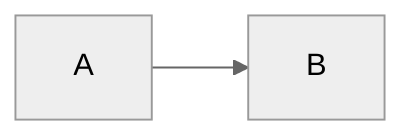

# Rendering and input comparison

[TOC]

## Whitespace and activation

Plain one    two.

Quoted "one    two".

First source line
second source line.

First hard line  
second hard line.

Plain **bold**, *emphasis*, ***nested***, `code`, ~~strike~~, ==highlight==,
H~2~O, x^2^, :smile:, :unknown_emoji_name:, &amp;, and escaped \*markers\*.

Multiline ` first
second ` code.

###Heading without a space

Setext first
second
======

## Lists and continuation

- First item
- Second item
  - Nested item

1. First numbered item
2. Second numbered item

- [ ] Incomplete **task**
- [x] Completed task

> Quote first line
> Quote second line
>
> Another paragraph.

> [!NOTE]
> Optional alert content.

Term
: Definition with **formatting** and $x^2$.

## Tables

| Text | Code and formatting | Math |
| :--- | :---: | ---: |
| First | **bold** | $x^2$ |
| Escaped \| pipe | `a\|b` | $\frac{1}{2}$ |
| Sparse |

After table: test entry/exit here.

## Mathematics

Ordinary $x$ formula.

Boundary spaces $ x $ and closing digit $x$2.

Currency $2 and $3 should be checked independently.

Alternate inline \(x^2\) delimiters.

\[
\frac{a+b}{c+d}
\]

$$
E = mc^2 \label{energy} \tag{1}
$$

Cross-expression reference: $\ref{energy}$.

$$
\newcommand{\localmacro}{x^2}
\localmacro
$$

Macro lifetime: $\localmacro$.

```math
\ce{H2O}
```

```tex
\frac{1}{\sqrt{x}}
```

## Code

```javascript
function example(value) {
    return value + 1;
}
```

```unknown-language
Literal code with *markers* and "quotes".
```

    Indented code with *literal markers*.

## HTML

Inline <kbd>Ctrl</kbd>, <sup>2</sup>, <ruby>漢<rt>かん</rt></ruby>,
and <span style="color:red">styled text</span>.

<details>
<summary>Disclosure title</summary>

**Markdown in disclosure content.**

</details>

<div id="authored-anchor">
HTML block content.
</div>

## Links and notes

[HTTPS](https://example.invalid/path), [HTTP](http://example.invalid/path),
[email](mailto:writer@example.invalid), and [relative file](./markdown-conventions.md).

Bare https://example.invalid/path and writer@example.invalid.

[Reference link][reference-id] and [heading link](#whitespace-and-activation).

[reference-id]: https://example.invalid/reference "Reference title"

Named note[^named], repeated note[^named], and inline note^[Rich **note** with $x^2$.].

[^named]: Note body with **formatting** and [a link](https://example.invalid/).

## Diagrams




```sequence
Alice->Bob: Message
Note right of Bob: Note
```

```flow
start=>start: Start
operation=>operation: Write
end=>end: End
start->operation->end
```

## Unicode and selection

中文标点，输入法。 English words. é and é. 😀 👩‍💻 👨‍👩‍👧‍👦.

Arabic العربية 123 English and Hebrew עברית 456 end.

## Duplicate heading

## Duplicate heading

## 中文标题 {#explicit-heading .example}

End of comparison fixture.
